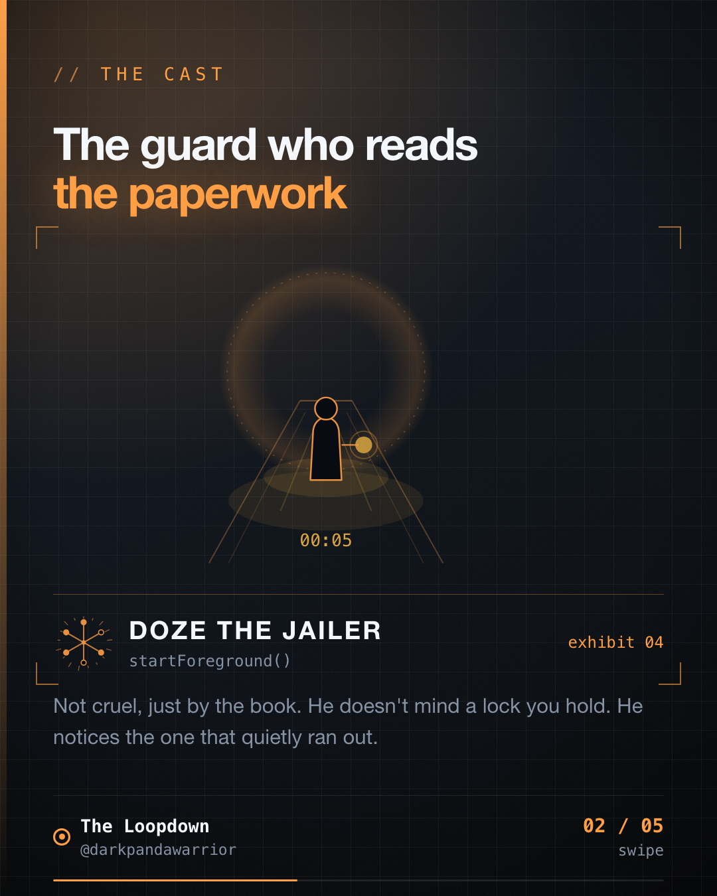

I put a one hour timeout on my wake lock so it could never leak. Then I went looking for the line that renews it, and there isn't one.



## The lock I was proud of

Doori's tracking service is a foreground service declared with `foregroundServiceType="location"`. When a trip starts, it also takes a partial wake lock:

```kotlin
private fun acquireWakeLock() {
    val pm = getSystemService(POWER_SERVICE) as? PowerManager ?: return
    wakeLock =
        pm.newWakeLock(PowerManager.PARTIAL_WAKE_LOCK, "mileway:tracking").apply {
            setReferenceCounted(false)
            acquire(WAKE_LOCK_TIMEOUT_MS)
        }
}
```

The timeout is a private constant at the top of `LocationTrackingService.kt`: sixty minutes, with a comment calling it a safety cap. It gets released when tracking stops, and again in `onDestroy` for the case where the user swipes the app away and the OS tears the service down without a clean stop. If you've read the Android docs on wake locks, this is the shape they want. A lock with no timeout is a battery bug waiting for an exception path you forgot, and I'd rather ship the guard than the bug.

## The search that spoiled it

I was in the file for another reason and searched for `acquire`. One call site, in the trip-start path. No heartbeat. No renewal. Nothing that runs at minute 59.

So the code reads as "hold the lock for the trip" and behaves as "hold the lock for the trip or for an hour, whichever comes first". For most trips those are the same sentence. For a long drive they aren't, and the difference is invisible, because an expired wake lock doesn't throw, doesn't log, and doesn't show up in anything I watch.

## The constants that describe a lock I don't hold

While I was there I found a second set of numbers. `LocationTrackingConstants.kt` declares `WAKE_LOCK_TAG = "LocationTrackingService::WakeLock"` and `WAKE_LOCK_MAX_DURATION_MS = 10 * 60 * 1000L`, which is ten minutes. I searched the whole repo. No Kotlin file references either one.

The lock that runs has a different tag and a sixty minute cap. The file whose name says "constants" holds the numbers that don't matter, and the real timeout sits in a private constant elsewhere. Grep for the wake lock timeout and you land on the wrong one first. I did.

## What I don't know

Does anything go wrong at minute 61? I can't tell you. The foreground service is what keeps the process alive, and location callbacks wake the CPU on their own, so the honest answer may be "nothing you'd notice". I haven't run a two hour trip on a device with the battery profiler open, so I won't put a number here that I made up.

The claim I can make is narrower and still worth making. The code promises something for the length of the trip and keeps it for an hour, and nobody chose that. It happened because a safety cap and a lifecycle are two separate decisions, and I only made one of them.

## What I'd do

Pick one of three, and write the choice in the comment next to the constant:

1. Renew the lock on a schedule you can name (a timer that re-acquires before expiry).
2. Say in a comment why expiry is fine, and what carries the guarantee afterwards.
3. Drop the timeout, and own the release paths instead.

Then delete the constants that describe a lock you don't hold. Dead numbers in a constants file are worse than none, because the next reader trusts them.

Doze the Jailer isn't the villain of this one. He's the guard who notices your paperwork has an expiry date and you never filed the renewal.

Where does your code promise something it only keeps for an hour?

Filed from iteration 18 of the loop.
