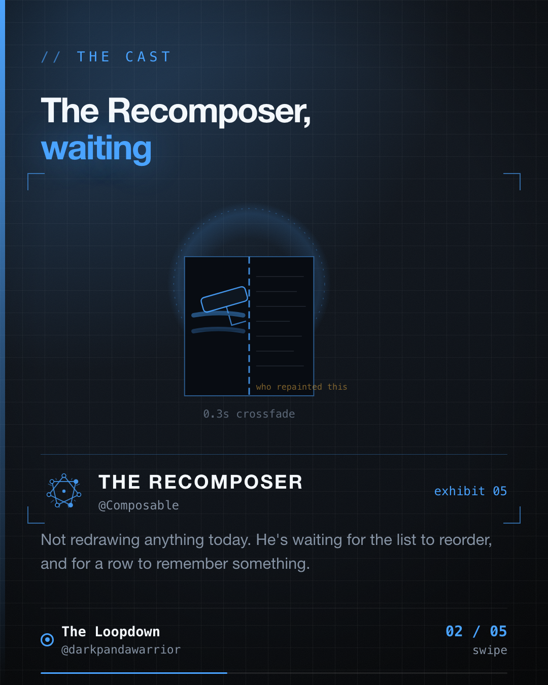

I found a chat list in my own app with no key, and nothing was wrong with it. That's the bug.



## What "no key" means

When you write `items(list) { ... }` without a `key`, a lazy list identifies each item by its position. Item 0 is item 0, whatever it contains.

That's fine while the list only grows at the end and no row remembers anything. It stops being fine when you insert above, delete, or reorder. From the change onward, every row is handed a neighbour's identity, along with any state it had remembered with `remember`. The row that was third is now fourth, and it's wearing the third row's expanded flag.

Giving the list a key (`key = { it.id }`) makes identity follow the item instead of the index.

## The list in my own app

Most of Doori's lists do pass a key. `CardsHomeScreen` has `items(cards, key = { it.id })`, and so do the offers hub, the what's new feed and the advances screens. Then I went looking for the ones that don't, and one is the Agent chat:

```kotlin
items(messages) { message ->
    AgentMessageBubble(
        message = message,
        onFeedback = { rating -> onFeedback(message.id, rating) },
        feedbackRating = feedbackMap[message.id],
    )
}
```

Position-keyed, in a list whose items have an `id` right there on the model. Is it broken?

I checked, and no. The reasons are lucky ones. A chat only appends, so positions never shift under existing rows. And `AgentMessageBubble` contains no `remember` at all. The thumbs up or down state lives in `uiState.feedback`, a `Map<String, Int>` keyed by `message.id`, hoisted out of the row. Identity by position never gets the chance to hand one message another message's state, because the rows hold none.

That design works because of two decisions made elsewhere, and neither is about the list. Someone adds `var expanded by remember { mutableStateOf(false) }` to the bubble, or the product asks to pin a message and the list reorders, and the missing key starts to matter. Nothing in the code would have warned them.

## Why it isn't five characters

Here's the part that stopped me from just adding the key. The model's id is built like this:

```kotlin
val id: String = "${if (isUser) "u" else "a"}_$timestampMs"
```

Two messages from the same side in the same millisecond would share an id. A keyed `LazyColumn` throws an `IllegalArgumentException` when it sees a duplicate key. Today that can't hurt, because nobody keys on the id. Add the key and you inherit a crash that was always latent.

So the honest fix has two halves: a unique id (a UUID, or the database row id) and then the key. One line in the composable, one decision in the schema. (Arrey bhai, the five-character version only exists in blog posts.)

## What I'd do

1. Add `key` when you write the list, not when something breaks. It costs nothing while the list is simple, and it's the only moment it's free.
2. Before you trust an id as a key, check it's unique. Timestamps aren't ids.
3. Prefer hoisting state out of rows keyed by id. It's what saved this list, and it's a good habit for its own sake.

The Recomposer isn't redrawing anything in this one. He's waiting for the list to reorder.

Filed from iteration 21 of the loop.
