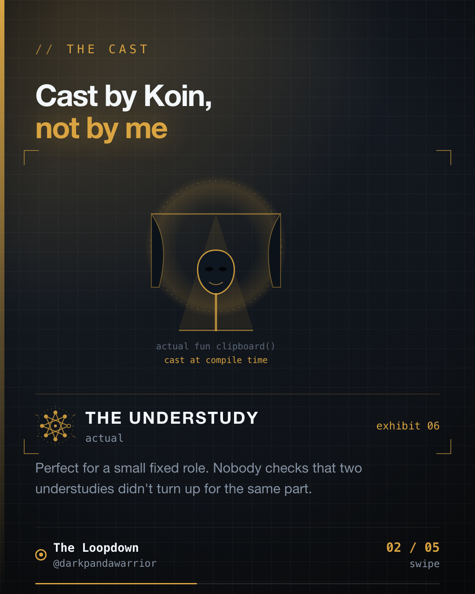

Adding a payment gateway to my app is one line. I'm proud of that line. Then I went looking for what happens when someone adds the same gateway twice.



## The design I like

PaymentsLab-KMP has one contract, `PaymentGateway`. Each provider is a Gradle module under `kmp-toolkit` that binds itself into Koin:

```kotlin
val razorpayModule: Module =
    module {
        single { RazorpayCallbackRelay } bind PaymentActivityCallbacks::class
        single { RazorpayGateway(get()) } bind PaymentGateway::class
    }
```

The orchestration module builds the registry from whatever has been bound to that type:

```kotlin
single<PaymentGatewayRegistry> { DefaultPaymentGatewayRegistry(getAll<PaymentGateway>()) }
```

Its comment says adding a provider is "a matter of including its module, with no edit here". In `PaymentsLabApplication`, that's one entry in the `modules(...)` list, next to `razorpayModule` and `stripeModule` and the rest. Features depend only on the registry interface. For the registry, the orchestrator and every feature, "provider N+1 touches no existing code" is accurate. I counted 70 gateways on 2026-09-07, so the next one is 71.

## Two caveats on "one line"

A single-instance provider also bumps a hand-kept constant in `ReadmeGatewayCountTest`. That one is at least a test, and it fails loudly if I forget.

The other caveat is the registry itself:

```kotlin
class DefaultPaymentGatewayRegistry(
    override val gateways: List<PaymentGateway>,
) : PaymentGatewayRegistry {
    private val byId: Map<GatewayId, PaymentGateway> = gateways.associateBy { it.id }
```

`associateBy` is documented to keep the last element when two share a key. So if two modules contribute a gateway with the same `GatewayId`, `byId` returns whichever comes last, while `gateways` still contains both. Nothing throws. One gateway becomes unreachable by id, and the first sign could be a flow opening against the wrong provider.

## What I searched for

I went looking for a guard. I searched the registry code and its tests for anything about duplicate, distinct or unique ids, and found nothing. The tests that construct a registry do it with one or two fakes.

I'm not claiming a duplicate exists today. I haven't proven it either way. The claim is smaller: if one appeared, nothing in the system would tell me.

## Why this is the price of the design

When a container assembles your list, no human ever reads all of it in one place. That's the benefit (nobody edits a growing `when` in the middle of the app) and it's also the cost, because any rule over the whole list has nowhere natural to live. Convenience at the edge and a missing check at the centre are the same decision, made once.

## The line I'd add

```kotlin
require(gateways.map { it.id }.distinct().size == gateways.size) {
    "Duplicate gateway ids: ..."
}
```

It runs when the registry is built, so it fails at startup, not mid-payment. It's the cheapest line in the file, and it's the one that makes "N+1 touches nothing" honest.

I haven't added it. This lesson is a note about my own code, and I'd rather say so than quietly fix it and pretend it was always there.

The Understudy is cast by name at compile time. Here the casting director is Koin, and nobody checks that two understudies didn't turn up for the same part.

Where does your DI assemble a list nobody reads?

Filed from iteration 22 of the loop.
