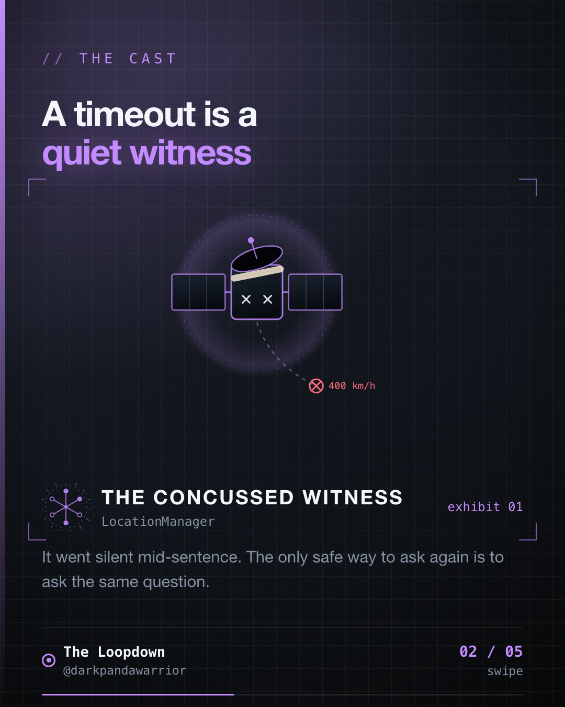

The user pressed Pay, the spinner spun, the request timed out. Did you charge them? If the honest answer is "probably not", something is wrong.



## Two statements that aren't the same

"The request failed" and "the charge did not happen" sound alike. On a payments client they are different claims, and the gap between them is where double charges live. A timeout is a witness who went quiet mid-sentence. You can only ask again if asking again is safe.

So the job isn't to make failures rarer. It's to make retrying safe by construction.

## The request with no amount

In PaymentsLab-KMP, the order request looks like this:

```kotlin
data class CreateOrderRequest(
    val catalogItemId: String,
    val gatewayId: String,
    val idempotencyKey: String,
)
```

There's no amount. The server resolves the price from `catalogItemId`, so a retry can't change the sum. What the request does carry is a key that, in the words of its own doc comment, is "client-generated once per logical order attempt and reused across retries of the SAME attempt".

## Who owns the key, and when it dies

The interesting design decision is the key's owner. It's the ViewModel, not the HTTP layer. In `CheckoutViewModel.pay` and `ProviderLabViewModel.start`, the first move is:

```kotlin
val idempotencyKey = current.idempotencyKey ?: Uuid.random().toString()
```

Reuse the attempt's key if there is one, otherwise mint a new one. The lifetime rules are all in state:

- If the payment fails, the key stays. Pressing Pay again is the same attempt.
- If it succeeds, the key is cleared (`if (terminal == SUCCESS) null else idempotencyKey`), so the next press is a new purchase.
- If the user changes the product or the gateway, the key is reset to null, because that's a different order.

A key tied to the HTTP request would die with the request. A key tied to the user's intent survives exactly as long as the intent does.

## The server's half

On the backend, the store writes the order record first and only then publishes the key-to-order mapping with `putIfAbsent`. A caller that loses the race returns the winner's order. The order matters, because publishing the mapping first would let a loser look up an order that hadn't landed yet.

There's a test for the ugly case. Eight concurrent `createOrder` calls with the same key must produce exactly one order id. A second test checks that different keys produce different orders, so the dedup isn't just returning the same order for everything.

Split payments extend this with no new idea. One purchase paid as a wallet leg and a gateway leg derives two keys, `"$key:wallet"` and `"$key:gateway"`, so replaying the whole split is as safe as replaying a single payment. If the gateway leg fails after the wallet leg succeeded, the wallet debit is reversed with a compensating credit.

## One brain

The protocol types, the orchestrator and both ViewModels live in `commonMain`. The platform bodies only host the payment SDKs. So one piece of code decides what "same attempt" means, on every platform that runs it. (Which is the whole argument for sharing logic: a rule like this one needs to be identical everywhere, and "identical" is hard to promise across two codebases.)

## What I can't tell you

Two limits, stated plainly. The backend in this repo is an in-memory store, and its own comments say so. Dedup there is process-local, and a real database would want a unique constraint on the key. And I haven't traced what the server returns when the same key is retried after a definitive decline, as opposed to an ambiguous timeout. That's a design question I'd want answered before this touched real money.

## What I'd keep

1. Put the key where the attempt lives, which is the ViewModel.
2. Tie its lifetime to the user's intent: survive a failure, change on a new purchase.
3. Let the server be the one that says "I've seen this before", and test it with concurrent calls.

"Probably not charged" isn't a state a payments client can be in.

How does your client know it's the same attempt?

Filed from iteration 23 of the loop.
